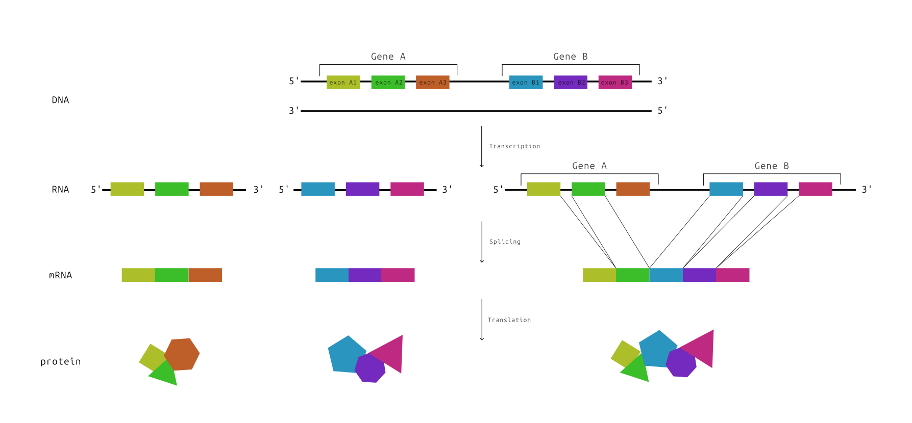

# Finding fusion-spliced proteins

For how we got to the hypothesis, check [here](./HISTORY.md).

## What

Fusion-spliced proteins are a hypothetical species of proteins that exist as a group of tandem protein-coding genes that are transcribed together and spliced into a single functional protein with domains from both protein transcripts. The constraint here is that the individual proteins have to be translated from non-overlapping exon sequences, exist and function separately when required. Or else it's just regular alternative splicing.

Let's take two genes, A and B. Most likely, they are transcribed independently (i.e. the mRNA transcripts are not linked), and translated independently (i.e. get processed by the ribosome separately, have separate chains). This would categorize them as two separate genes, transcripts, and proteins. Here, the two genes have their own splicing alternatives (only one if no other variant exists).

Then, the fusion-spliced alternative, protein gene AB, would be some combination of A's exons, optionally the integenic region's exons, and B's exons, taking at least some part of A and some part of B. 

This is visualized in this figure:

Even in this hypothetical scenario, we can think of some constraints that focus our search methods:
- Genes face the same way
- The STOP codon in the first gene is skipped by alternative splicing, and the last part of the sequence is joined with a protein coding sequence (rather than 5' UTR or a non-coding region)
- There is no frameshift in the splicing alternative
- Intergenic distance is below the threshold for the transcription machinery
- (Trivial) Genes are independently produced to become functional proteins

## Why is it interesting?

There are two different aspects that make this interesting, one is an evolutionary aspect, and the other one is novelty. 

Assuming they exist and we find them, this demonstrates another mechanism which shows how proteins evolve over time. With eukaryotic transcription and translation mechanisms, exons can evolve independently, and be shuffled around without the requirement of independent random evolution of proteins through indels and point mutations. Two genes mix and match exons, and through time, become a single gene that has all the splicing alternatives of the union of all. 

Novelty stems from the discovery of new proteins from the existing genomes, allowing researchers to investigate more proteins, potentially uncovering key proteins in different processes.

 
# Hypothesis Validation

The premise of the fusion-splicing alternative is based on the splicing mechanism in eukaryotes. The main source of evidence will come from RNA-seq data and the analysis of that. Supporting evidence can be made with evolutionary conservation.

### Conservation in evolution

A case for the existence of fusion-spliced proteins can be started to be built using evolution and conservation. If there exists an evolutionary pressure that conserves these aspects, we can start ruling out that what we observe is by chance. The null hypothesis is that we see this case by pure chance, and there is no evolutionary pressure involved that keep them together.

Specifically, these need to be conserved across a wide range of species:
- Genes are oriented the same way
- Intergenic distance is *below* a threshold
- Genes are in the same order (always A, then B; and not the other way around)

I will refer to them as the gene topology to keep it short. In short, it means the three properties above.
Conserved gene topology for both genes would signify evolutionary pressure to keep these genes not only close together, but in a way that guarantees that the transcription machinery can produce a single strand of mRNA. Without these, we reject our hypothesis.

###### Hypothesis: CCR2 and CCR5 have a splicing variant that splices both of these proteins into a single protein that is functionally relevant to the species.

### Fusion-spliced proteins from RNA-seq data

The golden standard in proving a protein exists, is multi-layered. The closer to the source (i.e. the protein itself, from a cell) the better the evidence. The case weakens when we move further away from the actual protein. Evidence at the DNA level is weaker than RNA, and that is weaker than protein.

One might rightfully ask if that's a pseudogene if found at the DNA level, or ask if the mRNA is even translated at all if found at the RNA level. Since we have no direct means of measuring at the protein level, we will try to find evidence for fusion-spliced proteins at the RNA level. 

The goal is to look at raw RNA-seq data, and try to align them to genomic regions where two genes are topologically fusion-ready (intergenic distance and orientation, order doesn't matter here since we're not looking at conservation). From there, we will do further analyses to build more support.

# Finding fusion-splicing cases

Although the search started with two GPCR proteins, the search pipeline aims to cast a wide net to catch all potential cases. The project will analyze RNA-seq data and will try to find fitting candidates. Then, for these cases, we plan to gather more supporting evidence from evolutionary conservation and maybe other aspects.

## Finding candidates

### Creating the list of candidates

To start looking at the genomes of species and filtering out the gene pairs that could fit our criterias, we need a threshold distance that the transcription mechanism is noted to tolerate. If two genes are spliced together, the intermediate section will be an intron. 
If we know the distribution of intron lengths, we can start finding gene pairs that are close enough to be linked together by an intron.

We take the species' genes that are alternatively spliced, and get the intron positions of each gene. From this, we will get the basepair difference between exons, to have a rough measure of how long an intron can be.

### Looking at expression profiles

### Looking for an RNA transcript that joins the CDS from one gene to the next

### Results
